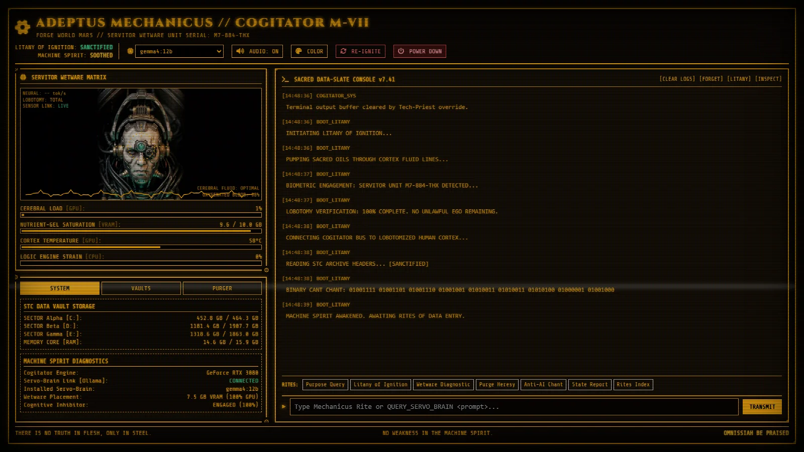

# Cogitator M-VII

*An unofficial fan-made servitor console, inspired by Warhammer 40,000, running entirely on your own PC.*

A CRT-styled Adeptus Mechanicus terminal that wires a **local LLM** (via [Ollama](https://ollama.com))
into a lobotomised servitor persona, and feeds it **real readings from your machine**: GPU load,
temperature and VRAM, CPU, RAM, disks and running processes, all rendered as Mechanicus wetware telemetry.
Nothing leaves your computer; there is no cloud API.

> **Unofficial fan project.** Not affiliated with or endorsed by Games Workshop. See [Disclaimer](#disclaimer).

## Features

- **Servitor chat** with streaming replies, conversation memory, HALT (Esc) and a model picker.
- **Live host augury.** Cerebral load = GPU, nutrient-gel = VRAM, cortex temperature = GPU temp.
  The servitor is given the live readings, so "report thy state" answers with real numbers.
- **Data-vaults.** Drop `.txt` / `.md` / `.log` files into `vaults/`; the servitor answers from them,
  names the record, and says so when a record does not exist instead of inventing it.
- **One-click start, sure shutdown.** `Cogitator.bat` starts everything and opens the browser. Closing the
  tab (or POWER DOWN) unloads the model from VRAM and stops the backend. Nothing lingers.
- **Lore gap pilot** ([pilot/REPORT.md](pilot/REPORT.md)): a 12B local model got 1 of 41 Adeptus Mechanicus
  lore specifics right on its own, and 41 of 41 with a few vault records.

## Requirements

- Windows 10/11 (the backend is plain Python and should run elsewhere, but only Windows is tested)
- [Python 3](https://www.python.org/downloads/) (`psutil` is installed automatically on first run)
- [Ollama](https://ollama.com/download) with at least one chat model, e.g.
  `ollama pull gemma4:12b` (default; needs ~8 GB VRAM) or `ollama pull qwen2.5:7b` (lighter, faster)
- An NVIDIA GPU for GPU telemetry (`nvidia-smi`); without one, the console still works and says so

## Run

Double-click **`Cogitator.bat`**. A console window titled *"close this window to shut down"* opens, then the
console opens in your browser at `http://localhost:8077`.

Or by hand: `python server.py` (add `--no-browser` to skip opening a tab; set `COGITATOR_PORT` to change the port).

Opening `cogitator.html` directly from disk does **not** work: Ollama only accepts requests from `http://localhost` pages.

## Rites (commands)

`HELP`, `QUERY_SERVO_BRAIN <question>` (or just type), `INSPECT_WETWARE`, `INIT_LITANY`, `PURGE_HERESY`, `FORGET`.
The PURGE button in the threads tab is ceremonial: the console never kills real processes.

## How it works

- `cogitator.html`: the whole UI, talking to Ollama directly at `localhost:11434`.
- `server.py`: a small localhost-only bridge that serves the page, reads hardware telemetry, serves the vaults,
  and shuts itself down when the last console tab closes (heartbeat + watchdog).
- `pilot/`: the lore knowledge-gap experiment: questions with sourced reference answers, the probe script, results.

## Credits

The original console design was generated with Google Gemini, then rebuilt for local models with Claude Code.
The servitor portrait (`assets/servitor.webp`) is AI-generated artwork made by the project author.
Fonts: VT323, Cinzel, Share Tech Mono (Google Fonts, SIL OFL). Icons: Font Awesome Free. Styling: Tailwind CSS.

## Disclaimer

This is an **unofficial, non-commercial fan project**. It is not affiliated with, endorsed, sponsored or approved by
Games Workshop Limited.

Warhammer, Warhammer 40,000, 40K, Adeptus Mechanicus, Horus Heresy, Black Library, Games Workshop and all
associated names, characters, places, factions and imagery are ® and/or ™ and/or © Games Workshop Limited,
variably registered around the world. They are used here without permission, purely descriptively and for
non-commercial fan purposes. No challenge to their status is intended.

This repository contains **no Games Workshop artwork, logos, models, rules text or text copied from books or
codexes**. The lore facts in `pilot/` and the vault drafts are short paraphrased summaries with links to their
public sources. The model answers in `pilot/answers_*.json` are machine-generated and often wrong; they are
kept as experiment data, not as lore.

Nothing here is sold or monetised. If Games Workshop asks for anything to be changed or removed, it will be.

The code is released under the [MIT License](LICENSE). That licence covers only the original code in this
repository, not any Games Workshop intellectual property.
